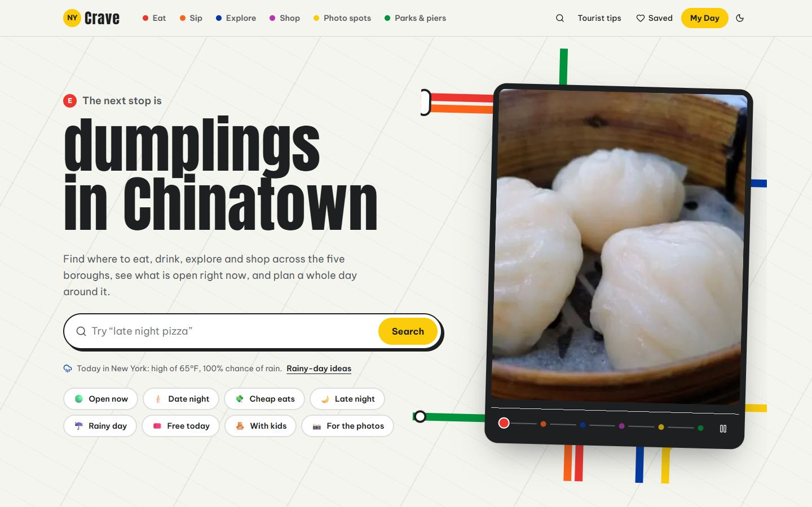
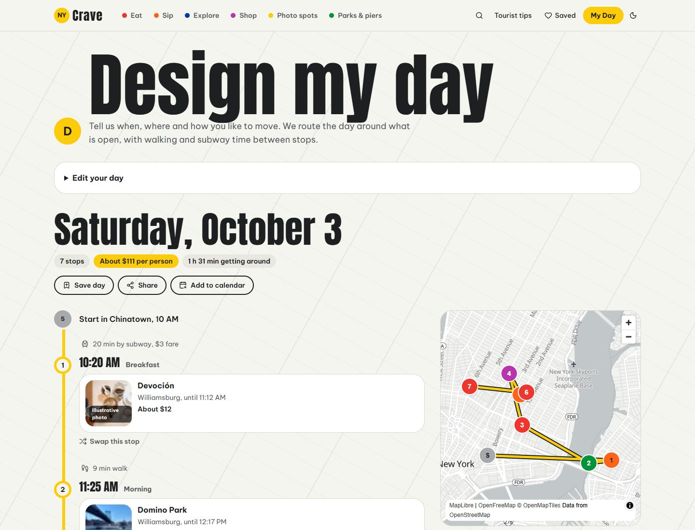
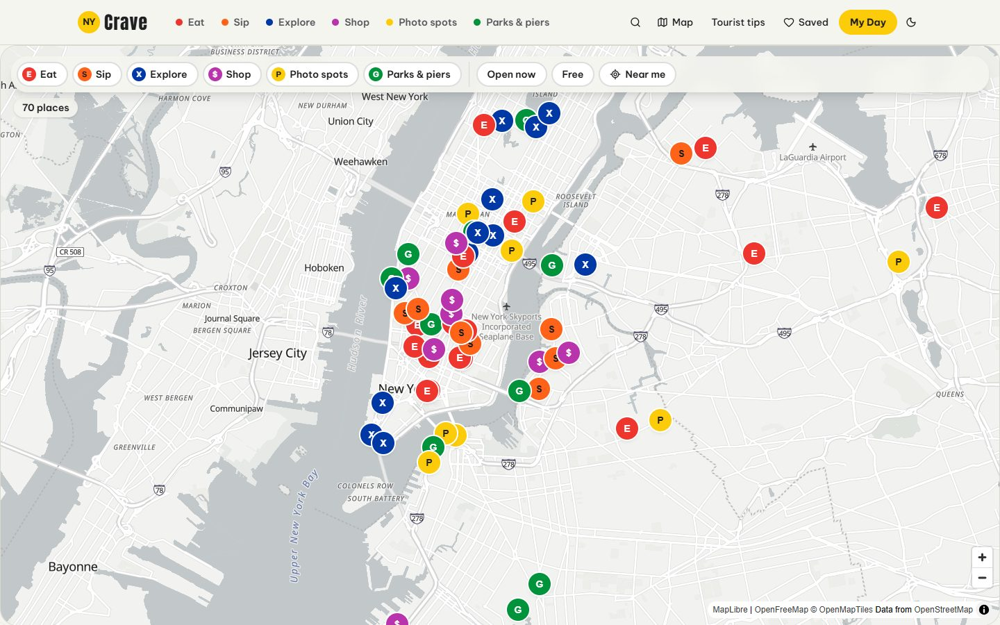
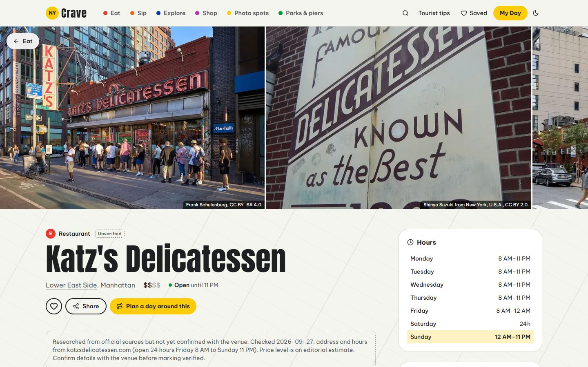
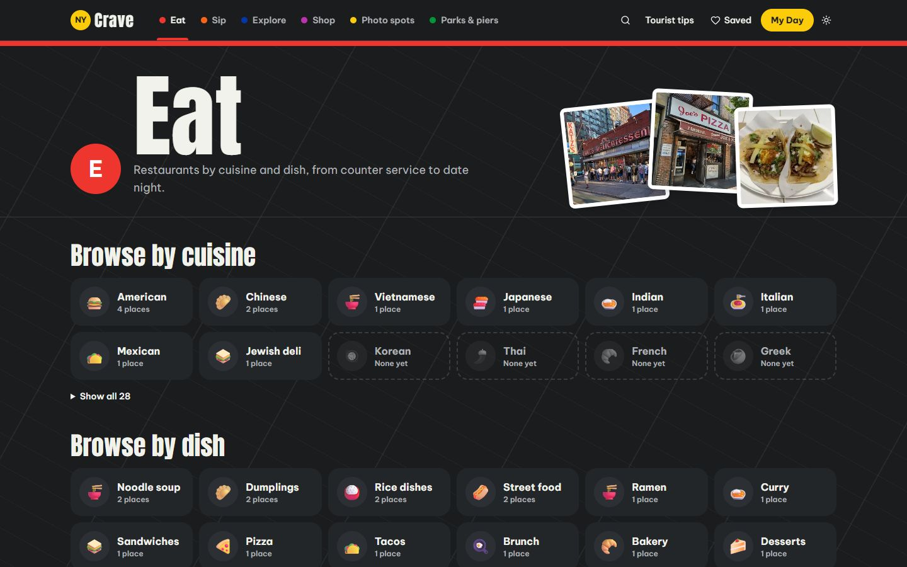

# NYCrave

**New York, one craving at a time.**

NYCrave is a mobile-first guide to New York City for locals and visitors: where to eat, what to sip, what to see, where to shop, where to take the photo, and which park to end the day in, plus a planner that builds a whole day around what is actually open.

**Live site: [nycrave.vercel.app](https://nycrave.vercel.app)** · English, Vietnamese, Spanish, Chinese and Korean



## Overview

- **Real places, honestly sourced.** Every restaurant, bar, museum, shop, photo spot and park is checked against its official website, with licensed photos and credits.
- **Live, in New York time.** Every place shows whether it is open right now, including late-night hours past midnight.
- **Plans, not just lists.** Design My Day turns a mood, a budget and a starting point into a timed route with walking and subway time between stops.
- **Built like the subway.** Each section is a line with its own color, and the whole site looks like a food magazine that fell for the subway map.

## Features

| | |
| --- | --- |
| 🔴 **Eat** · 🟠 **Sip** · 🔵 **Explore** · 🟣 **Shop** · 🟡 **Photo spots** · 🟢 **Parks & piers** | Browse by cuisine, dish, drink or shop type, with filters for open now or open at any day and time, free, within walking distance, step-free subway nearby, borough, neighborhood, price, vibe and dietary needs, sorted by trending, name, price, distance or what stays open latest, as a list or a clustered map; share or copy any filtered view, or let it pick one for you |
| **Smart search** | Plain phrases in any of the five languages: "dumplings in Chinatown", "late night pizza", "trà sữa", "atracciones gratis", "唐人街 饺子", "차이나타운 만두". Forgives typos, remembers recent searches, sorts results by kind with *Open now*, *Open at…* and *Near me*, and <kbd>/</kbd> jumps to it from any page |
| **City map** | Every place on one map, grouped into line-colored clusters, with line toggles, *Open now*, *Open at…*, *Free*, *Near me*, your saved places only, a jump to the nearest open place, and the same places as a list; the filters stay in the link |
| **Design My Day** | A timed day from breakfast to a nightcap, within budget, starting from any neighborhood or near you, with the train to take between stops; swap stops, share, copy as text, print, add to calendar or open the route in Google Maps; saved places can become a day too |
| **Ready-made days** | A classic first day, a food crawl, Brooklyn by the water, art and museums, date night, and a $50 day |
| **Ask NYCrave** | A free helper on every page, in every language, that answers "where can I get…", "is … open now?", "plan a day in …" and "how do I get from JFK…" from NYCrave's own places and tips |
| **What's next?** | Places a short walk away that are open when you get there, picked for what you just did |
| **Open late** | Pick 10 PM, midnight, 2 AM or 4 AM and see what is still open tonight or any night this week, and copy the list for a group chat, with closing times, nearest first if you like |
| **Ride the subway** | Every train as a strip map and a map, with the places a short walk from each stop, whether each is open (or only what is open now), and accessible stations marked; *Lines near me* finds the trains closest to you |
| **Food crawls** | Pizza, dumplings, bagels, noodles, bakeries, coffee and cocktails: three or four places a short walk apart, drawn as a strip map, with a walking route, how far each starts from you, and a copy-as-text version to send |
| **Guides** | Free NYC, rainy day, with kids, late night, date night, cheap eats, solo, outdoors and history, each with tips, a map, *Open now* and *Open at…* switches, a random pick, copy as text and a one-tap day planned around its nearest places; the home forecast suggests one for the weather |
| **The New York menu** | The city's signature foods, from the slice to pastrami on rye, and where to try each one, nearest first if you like |
| **Walks & hikes** | Forest trails, waterfront paths and bridges in all five boroughs, with distance, difficulty and the nearest subway, nearest first if you like |
| **Golden hour** | Today's light as a live sky ribbon, tonight's golden hour and tomorrow's sunrise for your calendar, and photo walks timed so every stop lands in its best light |
| **Seasons** | Manhattanhenge, cherry blossoms, the marathon and the holiday windows, with countdowns and an *Add to calendar* link for each |
| **NYC Passport** | Stamp the places you visit and earn 14 badges, from Pizza pilgrim to Line hopper |
| **Place pages** | Breadcrumbs, full-screen photos, a clean printout, live hours with a week chart, must-try items, tickets, nearest subway stations, directions, how far it is from you, and today's golden hour for photo spots |
| **Neighborhood guides** | Find any neighborhood by name, borough or what is near you, or see them all on one map, each with its places, subway lines and a *Plan a day starting here* button |
| **Tourist tips** | Airports, the subway and OMNY, tipping with a bill calculator, safety, and the city through the seasons |
| **Five languages** | English, Vietnamese, Spanish, Simplified Chinese and Korean, switched in the footer |
| **Works like an app** | Installable, saved places work offline, the time, open places, sunset and your saved days on the home page, new and recently viewed places, saved places by kind, open now or at any time, nearest first, shared or copied as text, an *Install the app* button, light, dark or device theme, keyboard shortcuts (<kbd>?</kbd>, and <kbd>g</kbd> then a letter to jump between pages), holiday and weather notices |

## Screenshots

| Design My Day | City map |
| --- | --- |
|  |  |
| **Place page** | **Eat, in dark mode** |
|  |  |

## How to use it

1. **Search or browse.** Type a craving on the home page, tap a mood, or pick a line.
2. **Narrow it down.** Turn on *Open now*, pick a neighborhood, or tap *Near me*.
3. **Open a place** for its hours, what to order and how to get there. Tap the heart to save it.
4. **Plan the day** in *My Day*, or start from a ready-made day. Swap anything, then share it.
5. **Ask NYCrave** anything along the way, and add the site to your home screen.

## Built with

Next.js 16 · TypeScript · Tailwind CSS v4 · shadcn/ui · next-intl · MapLibre and OpenStreetMap · Open-Meteo · MTA open data · Vitest · optional Supabase, Google Places and Claude

```bash
npm install
npm run dev        # http://localhost:3000
npm run check:websites   # find places whose official site moved or went dark
npm run check:hours      # compare hours with what official sites publish
```

Everything runs without keys; optional services are listed in [.env.example](.env.example). Photos are resized to WebP at build time (`scripts/photo-variants.mjs`), and listings are cached pages filtered in the browser, so the site runs comfortably on a free hosting plan.

---

Photos are from Wikimedia Commons under free licenses; every photographer is credited on the site's *Photo credits* page. Map data © OpenStreetMap contributors. NYCrave is an independent project, not affiliated with the MTA or any venue listed.
